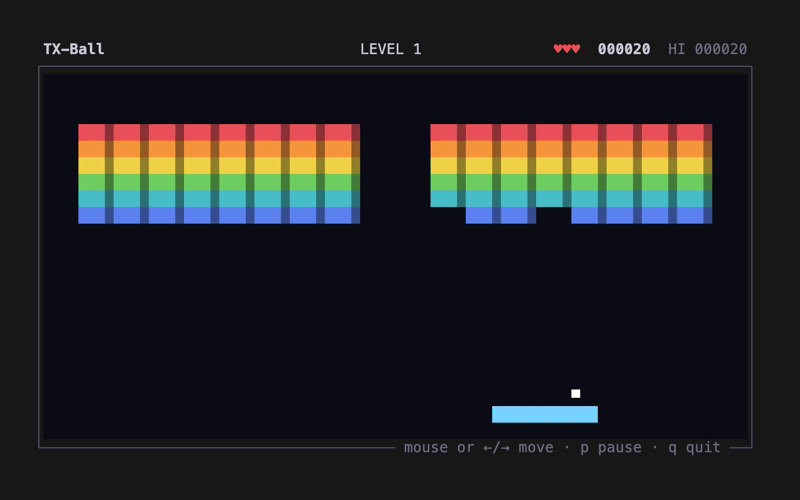

# TX-Ball

[](https://github.com/Allen-Iype/txball/actions/workflows/ci.yml)
[](https://github.com/Allen-Iype/txball/releases/latest)
[](https://pkg.go.dev/github.com/Allen-Iype/txball)
[](https://goreportcard.com/report/github.com/Allen-Iype/txball)

A brick-breaker for the terminal, written in Go with [tcell](https://github.com/gdamore/tcell).
Mouse-controlled paddle, half-block graphics, levels in plain text files and seven power-ups.



## Install

**Download a binary.** Grab the archive for your system from the
[latest release](https://github.com/Allen-Iype/txball/releases/latest) (macOS, Linux and Windows,
Intel and ARM), unpack it and run `txball`.

On macOS, a binary downloaded with a browser is quarantined because it isn't signed. Clear that
once with:

```sh
xattr -d com.apple.quarantine ./txball
```

**Or build it with Go** (1.25 or newer):

```sh
go install github.com/Allen-Iype/txball/cmd/txball@latest
txball
```

**Or run from a checkout:**

```sh
go run ./cmd/txball
```

### Terminal requirements

- At least **82 × 25** cells. Smaller than that, the game pauses and asks for more room.
- **Mouse reporting with motion tracking**, so the paddle can follow the pointer without a button held.
  iTerm2, Ghostty, kitty, WezTerm and Alacritty support it. In Terminal.app, turn on
  *View → Allow Mouse Reporting*. Inside tmux, `set -g mouse on`.
- True colour looks best; tcell falls back to the nearest palette colours without it.

## Controls

| Input | Action |
|---|---|
| Mouse | Move the paddle |
| Click or `Space` | Launch the ball; release a ball held by the sticky paddle; continue from the level-clear and game-over screens |
| `←` `→` or `A` `D` | Move the paddle (fallback) |
| `P` | Pause / resume |
| `Q`, `Esc` or `Ctrl-C` | Quit |

The mouse is the real control. Terminals report key presses but not releases, so keyboard
movement goes in short bursts.

Where the ball lands on the paddle sets the angle it leaves at: dead centre sends it straight up,
the edges send it out at up to 60° from vertical.

## Bricks

| Looks like | Behaviour |
|---|---|
| Coloured | Breaks in one hit |
| Silver | Armoured: takes two or three hits, dulling with each |
| Dark checker | Indestructible; doesn't need clearing |

Every hit scores 10. Clear all the breakable bricks to move on. Each level the ball gets 8%
faster, up to 80%. After the last level the layouts repeat.

## Power-ups

About one broken brick in seven drops a capsule. Catch it with the paddle.

| Capsule | Effect | Lasts |
|---|---|---|
| `M` | Multi-ball: every ball splits into three (up to 12) | n/a |
| `L` | Long paddle | 20 s |
| `S` | Short paddle | 20 s |
| `F` | Fireball: balls plough through breakable bricks | 10 s |
| `G` | Sticky paddle: catches the ball until you launch it | 20 s |
| `W` | Slow ball | 15 s |
| `+` | Extra life (up to 9) | n/a |

Active effects count down in the top bar. They end when you lose a life or clear the level.
You only lose a life when the last ball is gone.

## Options

| Flag | Meaning |
|---|---|
| `-bell` | Ring the terminal bell when a ball hits a brick or the paddle, and when a life is lost |
| `-level N` | Start on level N |
| `-demo` | Let the game play itself |
| `-version` | Print the version and exit |
| `-debug` | Show FPS and update rate; keys `1`–`7` drop a capsule of each kind |

The high score is kept in `$XDG_CONFIG_HOME/txball/highscore`, or `~/.config/txball/highscore`
when that variable isn't set.

## Levels

Levels are text files in [`levels/`](levels), embedded into the binary and played in file-name
order. Each character is one brick:

```
; Diamond: armour thickens towards a solid core.
....................
.........aa.........
........bbbb........
.......cc22cc.......
......dd2332dd......
.....ee23##32ee.....
```

| Character | Brick |
|---|---|
| `.` | Empty |
| `a`–`g` | One-hit brick; the letter picks the colour |
| `2` `3` | Armoured brick taking that many hits |
| `#` | Indestructible |
| `;` at the start of a line | Comment |

A level is at most 20 columns by 14 rows. Short rows are padded on the right, blank lines are
ignored, and a level needs at least one breakable brick. To add a level, drop a new `NN.txt` into
`levels/` and rebuild; mistakes are reported with file, line and column.

## Development

```sh
go test ./...
```

| Path | Contents |
|---|---|
| `cmd/txball` | Entry point and flags |
| `internal/game` | State, physics and rules. No terminal dependency |
| `internal/level` | Level file parser |
| `internal/render` | Drawing with tcell |
| `internal/app` | Screen lifecycle, input and the game loop |
| `internal/score` | High-score file |
| `levels` | Built-in level files |
| `docs` | The demo GIF and the tape that records it |

The simulation runs at a fixed 120 updates per second in floating-point world coordinates, where
one unit is one half-block "pixel"; the renderer draws at 60 frames per second and is the only
place positions are rounded. Ball movement is swept rather than stepped, so a ball can't pass
through a brick however fast it is going.

Releases are built by [GoReleaser](https://goreleaser.com) when a `v*` tag is pushed; see
`.goreleaser.yaml`.

The GIF above is a terminal recording made with [VHS](https://github.com/charmbracelet/vhs) from
`docs/demo.tape`, using `-demo` because VHS can't move a mouse. To re-record it:

```sh
vhs docs/demo.tape
```

## License

[MIT](LICENSE)
